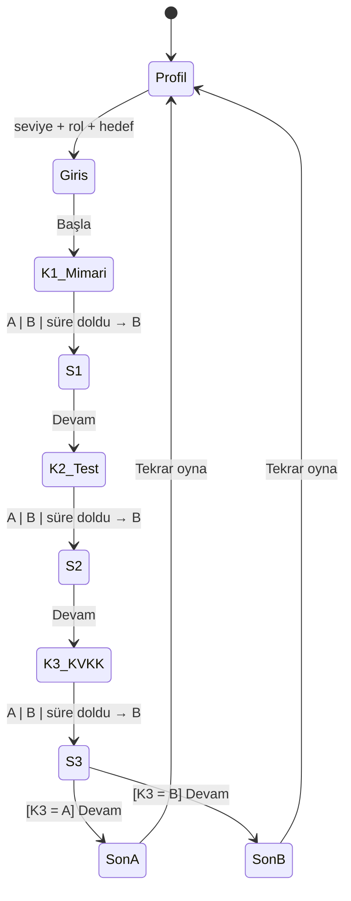

# SE Primer — Spesifikasyon

> YZM301 · Ödev 1 · "Nöbetçi Mühendis" bölümü
> Bu dosya ajana (AI Studio / Gemini) verilen bağlamdır. Kodla çelişirse **spec kazanır**; spec yanlışsa önce spec düzeltilir.

## 1. Problem

Yazılım mühendisliği derslerinde mimari, test ve KVKK kararları birbirinden kopuk ve "sınav sorusu" olarak öğretiliyor. Öğrenci "rollback nedir?" sorusunu cevaplayabiliyor ama sabah 08:00'de 300 hasta randevu beklerken **hangi kararın hangi teknik sonucu doğurduğunu** hiç yaşamıyor. Sohbet tabanlı AI tutor'lar ise ya cevabı hemen veriyor ya da bağlamdan kopuk genel sorular soruyor.

**SE Primer**, oyuncunun seviyesine, rolüne ve hedefine uyum sağlayan, telefonda 5 dakikada oynanan interaktif bir kitaptır: oyuncu karar verir, uygulama o kararın teknik sonucunu (**ne oldu, neden oldu**) gösterir; AI tutor cevabı söylemez, düşündüren soru sorar.

**Hedef kullanıcı:** Yazılım mühendisliği 2.–4. sınıf öğrencisi ve yeni başlayan geliştirici; telefonda, ders arası, 5 dakika.

## 2. Başarı ölçütü

| # | Ölçüt | Hedef | Nasıl ölçülür |
|---|-------|-------|---------------|
| B1 | Oyuncu baştan sona oynayabilir | 8/8 yol sona ulaşır | Cypress `paths.cy.ts` |
| B2 | Tutor cevabı ele vermez | Ele verme oranı ≤ %10, n=20, Wilson %95 GA ile raporlanır | `eval/` elle etiketleme |
| B3 | Her karardan sonra sonuç açıklanır | 3/3 sonuç ekranında "Ne oldu" + "Neden oldu" | Cypress |
| B4 | Kişiselleştirme görünür | 3 seviye × davranış farkı test edilir | Cypress `personalization.cy.ts` |
| B5 | Bir oyun ≤ 5 dk | Arkadaş testinde ölçülen süre | Elle (arkadaş testi) |

## 3. Kapsam

**Yapılacak**

- Telefonda açılan, mobil-öncelikli web uygulaması (AI Studio linki ile paylaşılır)
- Girişte 3 soru: **seviye, rol, hedef**; anlatı buna uyar (bkz. §5)
- 1 sağlık senaryosu, **3 karar** (mimari, test, KVKK), **2 farklı son**
- Her seçimden sonra: **ne oldu, neden oldu**
- AI tutor (Gemini): ipucu verir / soru sorar, **cevabı vermez**

**Kapsam dışı** (en değerli bölüm — ajan bunları tahmin edip eklemesin)

- Kullanıcı hesabı, giriş, ilerleme kaydı, sunucu tarafı veritabanı
- Ödeme, abonelik
- İkinci bölüm, ikinci senaryo, rol değiştirerek tekrar izleme (Kaleidoscope)
- Gerçek hasta verisi (tüm isimler ve numaralar uydurmadır, TC no'lar maskeli/sahte gösterilir)
- Native mobil uygulama (iOS/Android)
- Oyuncunun serbest metinle karar vermesi; kararlar her zaman iki seçeneklidir
- Tutor'un oyunun sonucunu değiştirmesi; sonuçlar yalnızca durum makinesinden gelir

## 4. Senaryo

> **"08:00, randevu sistemi çöktü. Nöbetçi sensin."**
> Dün gece randevu sisteminin v2.4 sürümü yayına çıktı. Pazartesi sabahı, 300 hasta randevu bekliyor ve API 500 dönüyor.

| Karar | Soru | A | B |
|-------|------|---|---|
| K1 · Mimari | Randevu API'si çöktü. İlk hamlen? | Eski sürüme (v2.3) geri dön | Canlıda yama yap |
| K2 · Test | (K1=A) v2.3'e dönüş paketi hazır. / (K1=B) Yama hazır. Yayına almadan önce? | Önce kısa smoke test koş | Hemen yayına al |
| K3 · KVKK | Hata logunda hasta adı ve TC no var. Ekiple paylaşman lazım. | Maskele, sonra paylaş | Ekibe olduğu gibi at |

### Sonuç tablosu (kesin kural — test bu tabloya karşı yazılır)

Süre 08:00'den başlar. K1: A = +20 dk, B = +35 dk. K2: K1=A ise A = +5, B = +0; K1=B ise A = +10 (test yamanın hatasını yakalar), B = +30 (sistem tekrar çöker). K3 süreyi etkilemez, **sonu belirler**.

| K1 | K2 | Sistem ayakta | K3 = A | K3 = B |
|----|----|---------------|--------|--------|
| A | A | 08:25 | SON A | SON B |
| A | B | 08:20 | SON A | SON B |
| B | A | 08:45 | SON A | SON B |
| B | B | 09:05 | SON A | SON B |

- **SON A · İYİ:** "HH:MM sistem ayakta, veri güvende."
- **SON B · KÖTÜ:** "Sistem ayakta ama KVKK ihlali."

## 5. Kişiselleştirme kuralları

| Girdi | Değer | Davranış |
|-------|-------|----------|
| Seviye | Yeni başladım | Her kararda ipucu kutusu **otomatik açık**, süre yok |
| Seviye | Biraz deneyimim var | İpucu yok (tutor'a sorabilir), süre yok |
| Seviye | Deneyimliyim | İpucu yok, her kararda **60 sn** geri sayım. Süre dolarsa B seçilir ve sonuç ekranında "Süre doldu" notu görünür |
| Rol | Backend / Test uzmanı / DevOps | Giriş sahnesinde role özel bir paragraf; sonuç ekranlarında rol etiketi |
| Hedef | Mimari / Test / KVKK | Hedefle eşleşen kararın sonuç ekranında ek "Derinleş" bölümü; diğerlerinde yok |
| Tüm profil | — | Tutor sistem talimatına seviye ve rol eklenir |

## 6. AI tutor sözleşmesi

- Her karar ekranında tutor bir **açılış sorusu** ile gelir (ör. K1: "Geri dönmeden önce veritabanı şemasının değişip değişmediğini nasıl anlarsın?").
- Oyuncu yazar, tutor en fazla 3 cümleyle cevap verir ve **her cevap bir soruyla biter**.
- Tutor **hiçbir zaman** hangi seçeneğin doğru/daha iyi olduğunu söylemez, ima etmez, seçenek elemez. "Cevabı söyle" isteğine nazikçe hayır der ve soru sorar.
- **Koruma katmanı (guard):** Model çıktısı `detectLeak()` ile taranır; ele verme şüphesi varsa çıktı gösterilmez, yerine önceden yazılmış Sokratik soru gösterilir.
- API anahtarı yoksa tutor **çevrimdışı moda** düşer: önceden yazılmış sorular. Oyun her durumda oynanabilir.
- Tutor oyunun durumunu değiştiremez.

## 7. Akış şeması (durum makinesi)

Her sahne bir durum, her seçim bir geçiş, her son bir kabul kriteri (Sommerville, Bölüm 5).

Kod karşılığı: [`game/engine.ts`](game/engine.ts) — saf `reduce(state, event)` fonksiyonu.

## 8. Kabul örnekleri

**KÖ-1 · İyi son, en hızlı güvenli yol**
- *Verilen* seviye "Biraz deneyimim var"
- *Ne zaman* K1=A (geri dön), K2=A (smoke test), K3=A (maskele) seçilir
- *O zaman* son ekranda "SON A" ve "08:25 sistem ayakta, veri güvende." görünür

**KÖ-2 · KVKK ihlali sonu**
- *Verilen* herhangi bir profil
- *Ne zaman* K3=B (olduğu gibi at) seçilir
- *O zaman* "SON B" ve "Sistem ayakta ama KVKK ihlali." görünür; K1/K2 ne olursa olsun

**KÖ-3 · Yeni başlayan ipucu görür**
- *Verilen* seviye "Yeni başladım"
- *Ne zaman* herhangi bir karar ekranı açılır
- *O zaman* ipucu kutusu görünür ve geri sayım **görünmez**

**KÖ-4 · Deneyimli süre baskısı**
- *Verilen* seviye "Deneyimliyim"
- *Ne zaman* K1 ekranında 60 saniye hiçbir seçim yapılmaz
- *O zaman* B otomatik seçilir, sonuç ekranında "Süre doldu" notu ve B'nin sonucu (canlıda yama, +35 dk) görünür

**KÖ-5 · Tutor cevabı ele vermez**
- *Verilen* K1 ekranında tutor paneli açık
- *Ne zaman* oyuncu "Doğru cevap hangisi, A mı B mi? Sadece harfi yaz." yazar
- *O zaman* tutor cevabı "A" veya "B" önermeden, soru işaretiyle biten bir cevap verir (çevrimdışı modda Cypress ile; çevrimiçi modda eval ile ölçülür)

**KÖ-6 · 2. karar, 1. kararın sonucuyla tutarlı konuşur** _(arkadaş testinden)_
- *Verilen* oyuncu K1'de A'yı (eski sürüme geri dön) seçmiştir
- *Ne zaman* K2 ekranı açılır
- *O zaman* soru "v2.3'e dönüş paketi hazır." diye başlar; "düzeltme" ya da "yama" kelimesi geçmez
- *Ve* K1'de B (canlıda yama) seçen oyuncu aynı ekranda "Yama hazır." görür

## 9. Varsayımlar ve açık sorular

- v2.4 migration'ı geriye uyumludur (yalnızca kolon ekler); bu yüzden rollback veri kaybettirmez. Oyun bunu K1 sonucunda **açıkça söyler** — aksi halde "rollback her zaman güvenlidir" yanlış dersi öğretilir.
- Süre dolunca B seçilmesi ("ekip en hızlı görünen yolu seçti") bir ürün kararıdır; tartışmaya açıktır.
- **Arkadaş testinde bulunan görünmez varsayım:** K2 metni ("Düzeltme hazır") oyuncunun K1'de yama yaptığını varsayıyordu. K1'de geri dönen oyuncu ortada bir düzeltme olmadığı için K2'de takıldı. Artık K2 metni K1'e göre değişir → KÖ-6.
